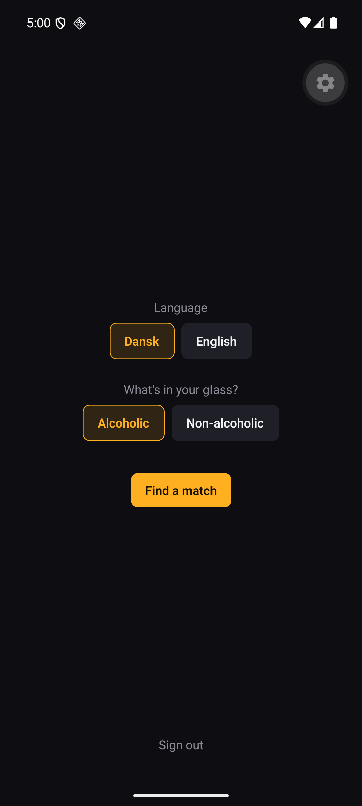
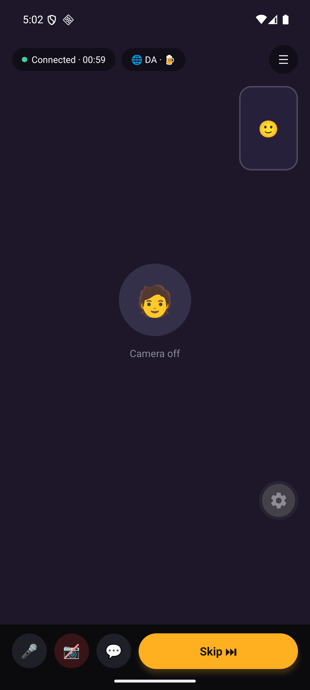
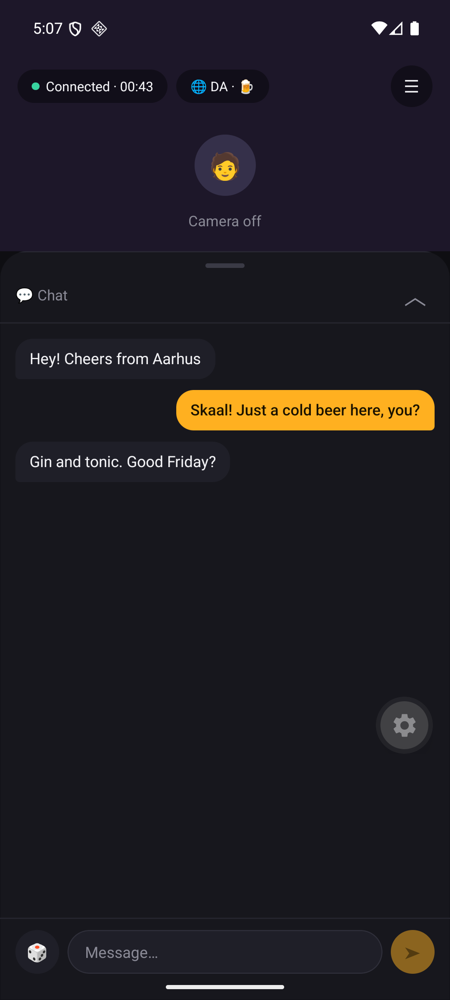
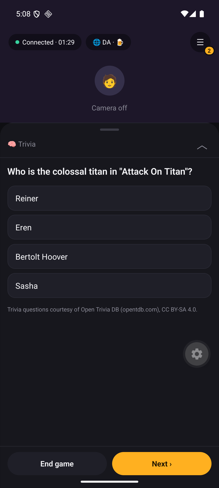

# DrinkingBuddy

[](https://github.com/NielsPilgaard/DrinkingBuddy/actions/workflows/ci.yml)

DrinkingBuddy randomly pairs you with a stranger for a 1:1 hangout over a drink, chat-roulette style. Pick a language and what's in your glass, tap match, and you're in a call. Video and audio are optional and text chat is always on. Skipping is free and unlimited. When the call ends, it's gone: no friends list, no history, no way to reconnect.

> **Status: pre-launch.** The first release is **Android only** and **Denmark only**, invite-only at first. iOS is planned. The app already builds for iOS, but it isn't tested or shipped there yet. "DrinkingBuddy" is a working name.

<p align="center">
  
  
  
  
</p>

## Features

- **Instant random 1:1 matching** filtered on language, drink type (alcoholic or non-alcoholic) and broad region. If nobody turns up within about 30 seconds, the app asks before it widens the search.
- **Video, audio and text** over WebRTC, with a self-hosted TURN relay for restrictive networks.
- **In-call extras:** a drink counter, ice-breaker prompts, and mini-games (trivia, would-you-rather, never-have-I-ever).
- **Accounts without passwords:** email magic link, 18+ only, plus a biometric or passcode check when a session is restored.
- **Safety:** report and block during or after a call, automatic suspension after repeated reports, and keyword flagging in chat. The webcam unlocks only after both people pass a selfie-based age check through [Didit](https://didit.me). Audio and text work without it.

Full product spec: [docs/prd.md](docs/prd.md). Stack decisions: [docs/tech-stack.md](docs/tech-stack.md).

## Tech stack

| Layer | Choice |
|---|---|
| Mobile | React Native (Expo, EAS Build), TypeScript, `react-native-webrtc` |
| API + signaling | Python, FastAPI, WebSockets |
| Data | Postgres (accounts, reports), Redis (ephemeral match queue) |
| Media relay | Self-hosted coturn (STUN/TURN) |
| Observability | Grafana, Loki, OpenTelemetry |
| Hosting | Single VPS, Docker Compose |

## Repo layout

```
backend/   FastAPI app, routers, models, Alembic migrations, docker-compose*.yml
app/       Expo React Native app
scripts/   setup, test, verify, phone dev loop
maestro/   Mobile end-to-end flows
docs/      PRD, tech stack, local dev, deploy, screenshots, mockups
tasks/     Task specs: open ones at the top level, done ones in completed/
```

## Getting started

### Prerequisites

- [uv](https://docs.astral.sh/uv/getting-started/installation/) (fetches Python 3.12+ itself)
- Node `^20.19.4 || ^22.13 || ^24.3` (see [app/.nvmrc](app/.nvmrc))
- Docker, for the backend stack and integration tests
- For Android builds: JDK 17–21 and the Android SDK (`ANDROID_HOME` set)

### Setup

```bash
./scripts/setup.sh          # macOS / Linux / Git Bash
./scripts/setup.ps1         # Windows (PowerShell 7)
```

Setup is idempotent. It checks prerequisites, creates `backend/.env` and `app/.env` from their `.env.example` files (it never overwrites an existing `.env`), and runs `uv sync --extra dev` and `npm ci`. Add `--up` / `-Up` to also start the backend stack and wait for `/health`.

The defaults in `.env.example` work for local development. You only need Didit keys (`DIDIT_*`) to try webcam age verification ([details](tasks/completed/10-age-verification.md)).

### Verify

```bash
cd backend && uv run pytest tests/unit                                # fast, no Docker
cd backend && uv run pytest tests/integration -m integration          # testcontainers, needs Docker
pwsh -File scripts/verify.ps1                                         # ruff, ty, biome, tsc
```

## Backend

The backend stack is FastAPI, Postgres, Redis, coturn, Mailpit and Grafana/OTel, all run with Docker Compose. `setup --up` starts it for you, or run it by hand:

```bash
cd backend
docker compose up -d --build --wait                                                       # needs the Loki logging plugin
docker compose -f docker-compose.yml -f docker-compose.windows.yml up -d --build --wait   # without it
```

| Service | URL |
|---|---|
| API | `localhost:8000` (`/health` → 200, `/docs` for OpenAPI). The `migrate` service runs migrations automatically. |
| Mailpit (magic-link emails) | `localhost:8025` |
| Grafana | `localhost:3000` (`admin` / `admin`) |

Container logs go to Loki through a host-level Docker plugin (`docker plugin install grafana/loki-docker-driver:latest --alias loki --grant-all-permissions`). Windows can't install it, and other hosts may not have it installed. In either case, use the `docker-compose.windows.yml` override. To run the API outside Docker, see [docs/local_dev.md](docs/local_dev.md).

## Mobile app (Android)

The app uses native modules (`react-native-webrtc` and the Didit SDK), so it needs a **development build**. Expo Go can't run it.

```bash
cd app
npx expo run:android        # emulator or USB device; needs Android SDK + JDK 17–21
# or build in the cloud: eas build --profile development --platform android
npx expo start --dev-client
```

JDK 24+ fails the native build at `configureCMakeDebug` with "A restricted method in java.lang.System has been called". Point `JAVA_HOME` at JDK 17 or 21.

**Physical phone over wifi (no cable):** run `./scripts/phone.sh --build` (Linux) or `./scripts/phone.ps1 -Build` (Windows) the first time. After that, run the same command without the flag. See [docs/testing_app.md](docs/testing_app.md).

**Backend URL:** if `EXPO_PUBLIC_API_URL` is unset, a dev build calls port 8000 on whichever host Metro serves from, so a phone on the same wifi needs no config. To force a specific backend, set the variable in `app/.env`. For the Android emulator, use `http://10.0.2.2:8000`, or use `localhost` together with `adb reverse tcp:8000 tcp:8000`.

**Testing matches:** matching needs two signed-in users, so use two devices or a device plus an emulator. Dev builds against the local stack sign in without the email step. Mobile end-to-end tests use Maestro: see [maestro/README.md](maestro/README.md).

### iOS (planned)

`npx expo run:ios` works on macOS with Xcode, and CI has an on-demand unsigned simulator build ([ios-build.yml](.github/workflows/ios-build.yml)). Device builds, TestFlight and App Store release come after the Android launch.

## Roadmap

[tasks/README.md](tasks/README.md) lists the open work in order. In short:

1. Deploy the backend to a VPS ([docs/deploy.md](docs/deploy.md)) and launch invite-only on Android in Denmark.
2. Set up a CSAM reporting runbook and test live age verification before real users join.
3. Before any public launch, add proactive AI nudity detection.
4. Later: iOS, a browser client, and other markets (each market needs its own alcohol-marketing and age-verification legal review).

## Contributing

Issues and pull requests are welcome. Before you start:

- [docs/prd.md](docs/prd.md) decides product behavior. Check it before proposing a feature change.
- Each task file in [tasks/](tasks/) has an "Explicitly out of scope" section. Keep changes inside it.
- Run the unit tests and `scripts/verify.ps1` before you open a PR. CI runs a fresh-clone setup, lint, typecheck, the tests and the full Compose stack.
- If you work with a coding agent, [AGENTS.md](AGENTS.md) has the repo conventions.

## License

[MIT](LICENSE)
